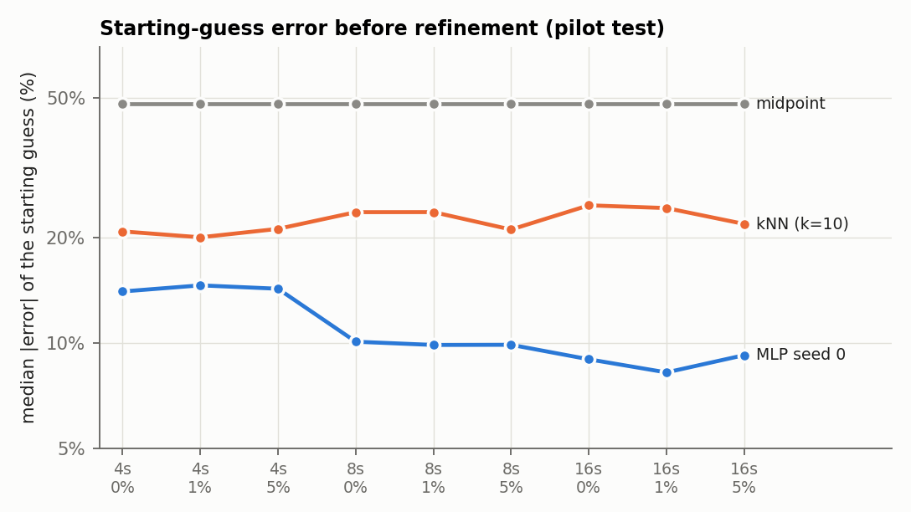
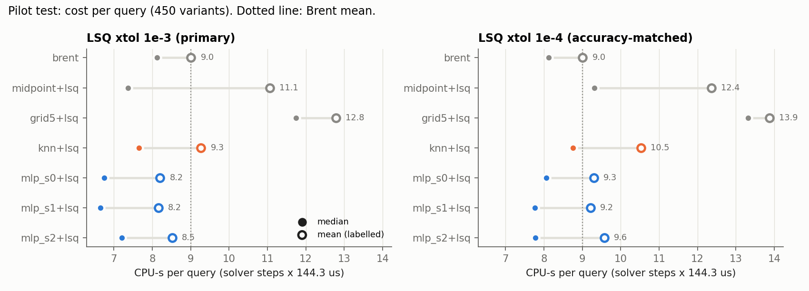
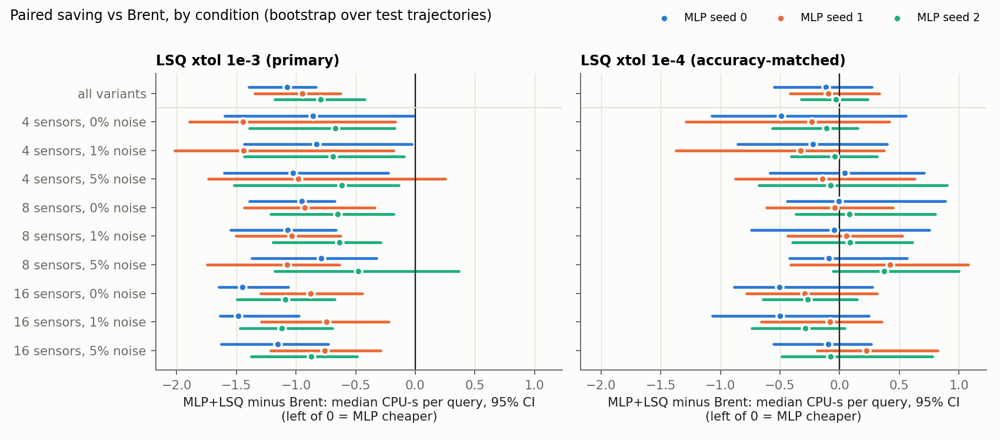
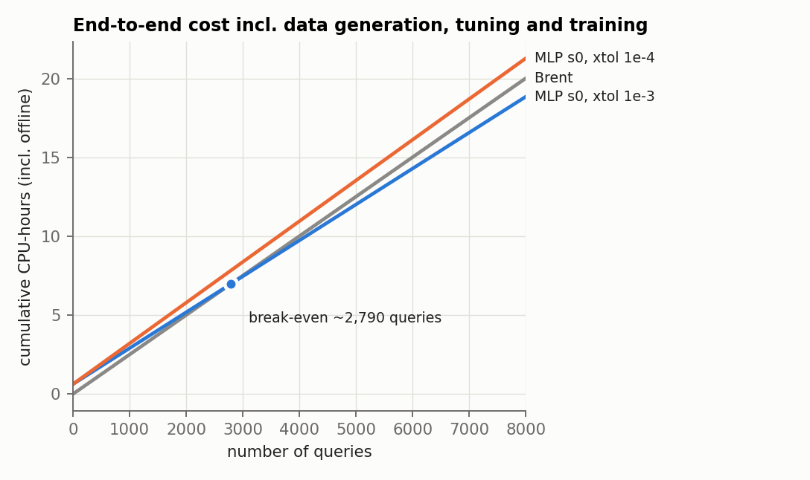
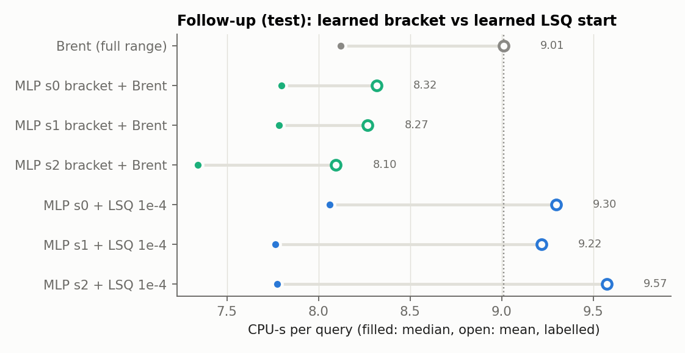

# Does a learned starting guess cut the cost of estimating Burgers viscosity? A cost-accounted, mostly negative result

*Draft report, AFML mini-project, Team Deadline Desperados. Written 2026-11-11 from the files in this repository.
Every number is taken from a result file named next to it.*

## Abstract
We estimate the viscosity ν of the 1-D viscous Burgers equation from 4–16 sparse, noisy velocity sensors, given the
initial condition, and ask whether a small MLP that predicts log ν reduces the end-to-end simulator cost of the fit. We
compare it against strong classical alternatives, with every forward solve counted and offline cost (data, tuning,
training) included. On a pre-registered pilot test set (50 trajectories × 9 sensor/noise conditions), the learned start
cuts the cost of a least-squares (LSQ) refiner by about 2 CPU-s per query versus a midpoint start. Against Brent's
bounded direct search, the strongest classical baseline, the saving depends on the LSQ stopping tolerance. It is
0.8–1.1 CPU-s per query (CI excludes 0, all 3 seeds) when LSQ stops loosely. It disappears (CI includes 0, all seeds)
when LSQ stops at least as precisely as Brent. The pre-registered success criterion is therefore not met, and neither
is the proposal's 2× target (best median ratio 1.22×). Accuracy is identical across methods and limited by the data,
not the optimiser. A separately pre-registered follow-up uses the MLP to set a ±0.5 (log-ν) bracket for Brent, keeping
Brent's own stopping rule. This version does give a small saving at matched precision: 0.7–0.9 CPU-s per query on
average (8–10%), with the CI excluding 0 for all 3 seeds and all 9 conditions, and break-even after ~2,400–3,300
queries. That is still far from 2×.

## 1. Problem
- **PDE.** u_t + (u²/2)_x = (ν/π) u_xx on [0,1), periodic. ν ∈ [0.01, 0.1] follows the PDEBench convention
  (Takamoto et al., 2022), so the effective diffusivity is ν/π. The convention was checked against PDEBench's source
  (`RESEARCH_LOG.md`, Session 1).
- **Known.** The initial condition u₀(x) = Σ_{k=1..3} a_k sin(2πkx + φ_k), with a_k ~ U(0,1) and φ_k ~ U(0,2π).
- **Observed.** Velocity at 16, 8 or 4 fixed sensors (nested, evenly spaced), at t = 0.25, 0.5, 0.75 and 1.0, with
  Gaussian noise of 0, 1 or 5% of the signal RMS.
- **Unknown.** ν, sampled log-uniformly.
- **Cost model.** Each forward solve is an explicit finite-volume simulation whose step count scales like 1/ν (the
  diffusive stability limit), so a solve at ν = 0.1 costs ~10× one at ν = 0.01. Cost is therefore reported in solver
  steps × 144.3 µs/step = CPU-s, as well as in solve counts.

## 2. Methods
**Simulator** (`blinit/simulator.py`). An independent NumPy float64 reimplementation of PDEBench's scheme: MUSCL with
the PDEBench limiter, Rusanov flux, central diffusion and a two-stage midpoint integrator, on nx = 256 cells. The test
suite checks it against the exact Cole–Hopf solution (grid convergence), the heat-equation limit (which explicitly
rejects the D = ν convention), shift equivariance (1e-12), mass conservation (1e-13) and grid convergence at the
sensors (~2nd order). At ν = 0.01 the 256-cell discretisation error is about the size of a 1% change in ν
(`results/phaseA/meta.json`).

**Inverse problem** (`blinit/inverse.py`). We minimise ½‖r(θ)‖² over θ = log ν ∈ [log 0.01, log 0.1], where r is the
residual at the available sensors. All methods share one `Problem` object, which counts every solve, including
finite-difference Jacobian solves, and memoises exact repeats in the same way for every method. Ground truth is used
only for scoring.

| Method | Start | Refinement |
|---|---|---|
| brent | none (full bounds) | `scipy minimize_scalar(bounded)`, xatol 1e-3 |
| midpoint+lsq | centre of bounds | bounded TRF least squares, 2-point FD Jacobian |
| grid5+lsq | best of 5 log-spaced solves | same LSQ |
| knn+lsq | IDW mean of k = 10 nearest training variants (same mask), tuned on validation | same LSQ |
| mlp_s{0,1,2}+lsq | MLP prediction (3 training seeds) | same LSQ |

**MLP** (`blinit/model.py`, `configs/phaseC_v2.json`). A 2×64 ReLU network (scikit-learn). Inputs are 64 standardised
readings (missing → 0), 64 mask bits and 6 IC features a·cos φ and a·sin φ. The target is standardised log ν, with
MSE loss and early stopping on validation. Training uses 3,000 trajectories × 9 variants. 4 tuning configurations
were tried, chosen on validation. Neural-only validation error: median 8–12%, p90 29–33% (`models/phaseC_v2/summary.json`).

**Data** (`blinit/data.py`). Splits are by initial-condition seed: 3,000 train, 50 validation and 50 test trajectories,
with all 9 sensor/noise variants of a trajectory kept inside its split. The normaliser is fitted on train only. 9
automated integrity checks pass, and the dataset regenerates bit-identically (`data/phaseB_v2/integrity.json`).

**Fairness protocol.**
- **Bounds and refinement:** identical across methods.
- **Tolerances:** chosen from development data only, with two LSQ tolerances bracketing Brent's precision
  (xtol 1e-3 is looser than Brent in the worst case; xtol 1e-4 is tighter).
- **Statistics:** paired per-variant differences, with a trajectory-level bootstrap (4,000 resamples).
- **Single use of the test set:** the pilot test was pre-registered before use
  (`docs/preregistration_pilot_test.md`, commit a9de91a) and run once per setting.

## 3. Results
### 3.1 Classical behaviour (development data)
- **Shape of the mismatch curve:** all 20 noise-free objective scans, and all 160 noise/sensor scans, have a single
  minimum.
- **No optimiser failures:** every method reaches the same optimum.
- **Hard cases are data-limited:** for example, the best achievable error at 4 sensors and 5% noise is a median of
  2.6% and a p90 of 14% (`results/phaseA_noise/`).
- **Floor on any initialiser's saving:** even a perfect (true-ν) start needs about 6 solves under LSQ with noise,
  versus 9–10 for Brent. So the best case is ~1.5× in solves (`RESEARCH_LOG.md`, Phase A′).

### 3.2 Starting-guess quality (test)

| Starting guess | Median error, 4 sensors | Median error, 16 sensors |
|---|---|---|
| MLP | 14–15% | 8–9% |
| kNN | 20–21% | 22–25% |
| Midpoint | 48% | 48% |

Source: `results/report/tables.json`, key `init_error_test`.

### 3.3 Cost at equal accuracy (pre-registered pilot test)

**Primary setting (Brent xatol 1e-3, LSQ xtol 1e-3)**

| Method | CPU-s mean | CPU-s median | Solves median |
|---|---|---|---|
| brent | 9.01 | 8.12 | 9 |
| midpoint+lsq | 11.06 | 7.37 | 10 |
| grid5+lsq | 12.79 | 11.75 | 12 |
| knn+lsq | 9.27 | 7.65 | 8 |
| mlp_s0+lsq | 8.20 | 6.75 | 8 |
| mlp_s1+lsq | 8.16 | 6.65 | 8 |
| mlp_s2+lsq | 8.52 | 7.21 | 8 |

**Accuracy-matched setting (Brent xatol 1e-3, LSQ xtol 1e-4)**

| Method | CPU-s mean | CPU-s median | Solves median |
|---|---|---|---|
| brent | 9.01 | 8.12 | 9 |
| midpoint+lsq | 12.37 | 9.32 | 12 |
| grid5+lsq | 13.88 | 13.32 | 13 |
| knn+lsq | 10.53 | 8.76 | 10 |
| mlp_s0+lsq | 9.30 | 8.06 | 8 |
| mlp_s1+lsq | 9.22 | 7.77 | 8 |
| mlp_s2+lsq | 9.57 | 7.77 | 8 |

Sources: `results/phaseD_v1_3seeds_test/analysis.json` and `results/phaseD_v1_tightlsq_3seeds_test/analysis.json`.

**Accuracy.**
- Every method in both settings has a median relative error of 2.2e-3 and a p90 of 2.6e-2 against the true ν.
- There are 0 simulator failures.
- Estimates differ from the best-found optimum by at most 3.4e-3 (primary) or 2.8e-4 (accuracy-matched) in relative ν,
  which is far below the error the data allows.

### 3.4 Paired comparison with Brent

Median paired difference, MLP+LSQ minus Brent, in CPU-s per query [95% CI]:

| Seed | Primary | Accuracy-matched |
|---|---|---|
| 0 | −1.07 [−1.40, −0.83] | −0.12 [−0.55, +0.27] |
| 1 | −0.95 [−1.35, −0.63] | −0.10 [−0.42, +0.33] |
| 2 | −0.80 [−1.18, −0.42] | −0.03 [−0.32, +0.24] |

- **Primary setting:** the CI excludes 0 in 25 of 27 seed × condition cells.
- **Accuracy-matched setting:** the CI includes 0 in all 27.
- **The mean saving changes sign:** it is −0.49 to −0.85 CPU-s with the primary tolerance, but +0.21 to +0.56
  CPU-s with the accuracy-matched one. In other words, the MLP is costlier on average when LSQ is held to Brent's
  precision.

**Secondary comparisons.**
- MLP versus midpoint, same LSQ: −1.9 to −2.5 CPU-s per query, with every CI excluding 0 in both settings.
- kNN versus Brent: no saving (primary −0.20 [−0.77, +0.62]; accuracy-matched +0.94 [+0.44, +1.65]).

### 3.5 Break-even

**Offline cost** is about 2,250 CPU-s:
- training-data generation (wall time × workers, an upper bound): 1,837 CPU-s;
- 4 tuning runs: 313 s;
- training one seed: 25–110 s.

**Break-even against Brent:**
- Primary setting: ≈2,600–4,500 queries.
- Accuracy-matched setting: no finite break-even, because the mean per-query saving is ≤ 0 for every seed.
- kNN: no finite break-even in either setting.

### 3.6 Pre-registered verdict
| Criterion | Result |
|---|---|
| Saving vs Brent with CI excluding 0 under **both** settings, for ≥ 2 of 3 seeds | **Not met** (0 of 3) |
| 2× median CPU ratio, Brent / MLP | **Not met** (1.13–1.22× primary; 1.01–1.05× accuracy-matched) |

### 3.7 Follow-up: a learned bracket for Brent (separately pre-registered)
Because the main comparison suggested the LSQ refiner, not the starting guess, sets the cost floor, we tested one
narrow alternative allowed after a no-go (`docs/WORKFLOW.md`, Phase E).

**Method.** The MLP prediction sets a bracket [θ̂ − w, θ̂ + w] for Brent, with Brent's own xatol 1e-3, so precision
matches the baseline by construction. If the estimate lands on an interior bracket edge, Brent re-runs on the full
bounds, and those solves count too.

**Choosing w on validation** (`results/followup_bracket_val/analysis.json`):

| w | Mean CPU-s | Fallback rate |
|---|---|---|
| 0.1 | 11.67 | 44% |
| 0.2 | 9.07 | 22% |
| 0.3 | 8.24 | 12% |
| 0.5 | 8.03 | 3.6% |
| Brent (full range) | 9.05 | — |

w = 0.5 was selected. The protocol was then committed (`docs/preregistration_followup_bracket.md`, commit bfd590c)
before a single test run.

**Test results** (`results/followup_bracket_w0.5_3seeds_test/analysis.json`):

| Method | CPU-s mean / median | Paired median vs Brent [95% CI] | Mean diff | Fallback rate | Break-even |
|---|---|---|---|---|---|
| brent | 9.01 / 8.12 | — | — | — | — |
| MLP s0 bracket | 8.32 / 7.80 | −1.04 [−1.32, −0.79] | −0.69 | 2.7% | ~3,260 queries |
| MLP s1 bracket | 8.27 / 7.78 | −0.96 [−1.23, −0.71] | −0.74 | 2.2% | ~3,020 queries |
| MLP s2 bracket | 8.10 / 7.34 | −1.11 [−1.39, −0.88] | −0.92 | 1.6% | ~2,380 queries |

- **The saving holds everywhere:** the CI excludes 0 in all 27 seed × condition cells.
- **Accuracy is unchanged:** median error is 2.2e-3 and p90 is 2.6e-2, the same as Brent, and estimates differ from
  Brent's by at most 3.3e-4 in relative ν.
- **Pre-registered verdict:** a positive saving is **established** (3 of 3 seeds).
- **2× target:** **not met**. The median CPU ratio is 1.04–1.11× and the mean ratio is 1.08–1.11×.

The paired median saving (≈1 CPU-s) is larger than the gap between the two methods' medians, because the saving is
spread unevenly across variants.

## 4. Discussion
**Why the headroom is small.**
- **One dimension, cheap search.** The objective is one-dimensional, smooth and unimodal on every case examined.
  Bounded Brent search therefore converges in about 9 solves from the full bounds, and a learned start can only remove
  part of that.
- **LSQ has a floor.** The LSQ refiner needs ≥ 2 solves per iteration (forward and FD Jacobian), and in the noisy
  setting about 6 solves even from the true ν. A starting guess with 8–15% median error leaves most of that floor in
  place.
- **Tolerance dominates the comparison.** The reported saving is sensitive to the stopping rule: the earlier speed-up
  came mostly from LSQ stopping loosely in the tail. A cost claim for learned initialisation in this setting is
  therefore only meaningful as an accuracy-vs-cost curve, not as a single speed-up number.

**What the learned component does well.**
- It makes the LSQ refiner itself about 25% cheaper than a midpoint start, robustly across all conditions.
- It is a much better starting guess than kNN on the same features: 8–15% versus 20–25% median error.
- Used as a *bracket* rather than a *starting point*, it gives the only saving over Brent that survives matched
  precision. The saving is small (8–10%), but consistent across seeds and conditions. This fits the explanation above:
  the learned information is worth about one or two golden-section/Brent steps, not a different convergence regime.

## 5. Limitations
- A single PDE with a scalar parameter, one IC family, nested evenly spaced sensor masks and a 50-trajectory test set.
  Phase F (scale-up, unseen sensor patterns, IC shift, finer-grid test data) was not run.
- The data comes from the same solver at the same resolution ("inverse crime"). Finer-grid data would add a 1–2%
  low-ν bias (Phase A).
- CPU cost is derived from solver steps at a fixed µs/step measured on one laptop, so the ratios are hardware-portable
  but the absolute seconds are not. The offline data-generation cost is an upper bound (wall × workers).
- The validation split was used for MLP early stopping, MLP tuning, kNN tuning and the bracket width. Only the test
  results support claims.
- The test split was used twice, each time under its own pre-registration: once for the main comparison and once for
  the follow-up. The follow-up was designed after seeing the main test result, so it is a post-hoc hypothesis tested
  on reused data, and needs confirmation on fresh trajectories (Phase F).
- The selected width w = 0.5 is the edge of the validation grid {0.1, 0.2, 0.3, 0.5}. A wider bracket might do
  slightly better, and this was not explored.
- The literature audit is a first pass (`docs/literature_audit.md`). Learned warm starts already exist (Sambharya et
  al., 2024; Zhou et al., 2023), so the contribution is the controlled, cost-accounted comparison, not the mechanism.

## 6. Reproducing
See `README.md`. Every figure here comes from `python -m blinit.experiments.report_figures`, which reads saved results
only.

## References
See `docs/bibliography.md` (verified entries only).
